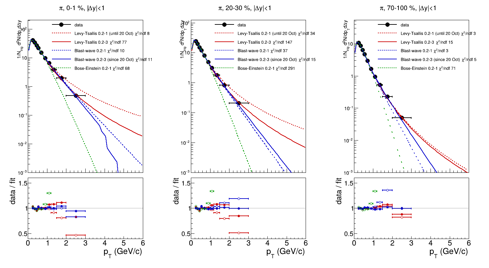
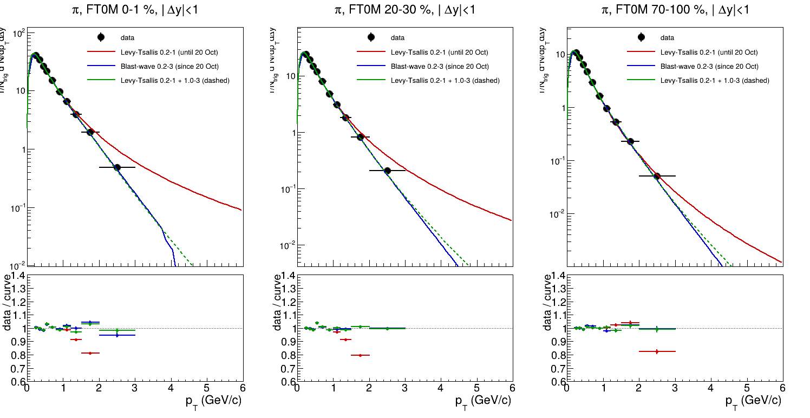

# The π extrapolation: the study behind the change of 20 October 2026

The comparison with the pre-framework K0S/π (`../README.md`) found that most of the 5 % between the two came
from the π yield: a tail of up to 3.5 % above the last measured point (3 GeV/c), integrated from a
Lévy-Tsallis fitted over 0.2-1.0 GeV/c that overshoots every point above 1 GeV/c. This folder holds the programs
that measured it and led to the π default becoming a blast-wave over 0.2-3.0, with the optional second fit of the
high side (`high` in `extrapConfig.json`) as the alternative, and the checks of the two ROOT behaviours found on
the way. What was concluded is in the main `DESIGN_NOTES.md` (section 6, *The extrapolation fit does not describe
the data*) and `DESIGN_HISTORY.md` (*A second fit for the high side*, *The toy fits and the saved curves*); this
is how to see it again.

```bash
enterO2P                                          # ROOT in the environment
cd Codes && ./runAnalysis.sh data pp --compile && cd ..
OldComparison/extrapolation/run.sh                # or run.sh <PhiAssocSpectra.root>
```

About forty seconds. The input is the 2024 file the comparison divides, under the comparison's binning, both read
from `../globalConfigComparisonOld.json` as `../run.sh` reads them. Everything goes to `output/` (not in git): the
tables, the figures, the logs, the ROOT files the figures are drawn from. `reference/` (in git) is what that gave
on 21 October 2026, on the output of commit `25fe5fb`, with the date in each name as in `../reference/`.

**What the study takes from the chain** is in `Chain.h`. Most of it is read from the input file itself: its spectra
by the names of `OutputNames`, its multiplicity classes from its binning stamp, and the extrapolation configuration
it was made with from its provenance (the whole `extrapConfig.json`), with the masses of `AnalysisConstants`. What
cannot be read is copied there once: the three options of `CorrelationTaskBase::ExtrapolateSpectrum` (local
constants in the chain), which `checks/asTheChain` verifies by remaking the file's extrapolated yields, and the π
starting points of the configuration before and after the change, for the study's own cases. A function of the
framework that both the chain and the study call would remove that copy; it is not there yet (`DESIGN_NOTES.md` section 10).

## The programs

| | what it does | gives (`output/`) |
|---|---|---|
| `modelScan.cpp` | every model of `ExtrapolationModelFactory` over 0.2-1.0 and 0.2-3.0 GeV/c, every class: convergence, χ²/ndf, the low-pT and high-pT parts of the yield, the yield | `modelScan.txt`; with `drawModels.C`, `pi_models.png` |
| `twoFits.cpp` | one fit for both sides against a low fit plus a separate high fit (the configuration before, the one since, three pairs): the yields relative to the first; data / fit above 1 GeV/c; the blast-wave against the two Lévy-Tsallis (χ² of the fits, χ² over the first three bins of the fit range); the blast-wave function above 3.5 GeV/c | `twoFits.txt`; with `drawTwoFits.C`, `pi_two_fits.png` |
| `checks/asTheChain.cpp` | every K0S, Ξ and π spectrum extrapolated again with the file's configuration, against the extrapolated trends the chain wrote | `checks_asTheChain.txt`, PASS if yields and errors agree within 1e-6 (the trends are `TH1F`) |
| `checks/toyGaus.cpp` | the statistical error: ROOT's shared `gaus` against a `TF1` of its own, and the K0S extrapolated after a π fitted two ways | `checks_toyGaus.txt`, PASS if the K0S error does not depend on the π |
| `checks/savedCurves.cpp` | a fitted curve written and read back, as a `Clone()` and as a copy, for 100 to 2000 points; the curves of the chain's output against the live functions of its configuration | `checks_savedCurves.txt`, PASS if the chain's curves read back within 1 % below 0.3 GeV/c |
| `checks/configHigh.cpp` | ten small `extrapConfig` files: `high` with `null` and a replacement in bin overrides, parameters merged by name, fixed, written as strings, and seven errors | `checks_configHigh.txt`, PASS if every case gives what it must |

The programs compute data / fit from the live functions and write it next to the curves; the two macros only draw.
`run.sh` builds each program with the chain's flags against `Codes/` (header-only) and stops at the first that does
not build, exits with a FAIL, or (for a macro) cannot find what it draws. Every other message goes to the
program's `.err`, and `run.sh` prints how many there are. Expected: a few dozen `TF1Helper::IntegralError` and GSL
round-off notices, from the error of the extrapolated bins (`SpectrumExtrapolator`: the uncertainty of an error
beyond the 1e-6 asked for); the chain prints the same kind by the hundred, outside its own count of warnings
(`DESIGN_NOTES.md` section 5). The framework's checks pass only with the code of 21 October 2026 or later; the
parts marked "ROOT" show ROOT's own behaviour and are expected to differ where they say so.

## What they show (`reference/`, 21 October 2026)



**One fit for both sides** (`modelScan`, and table 3 of `twoFits`). The Lévy-Tsallis over 0.2-1.0 (red dashed)
describes the points it is fitted to and overshoots above 1 GeV/c: data / fit 0.80 in 1.5-2 GeV/c and 0.51 in 2-3
(20-30 %), and the tail it integrates from 3 to 10 GeV/c is 0.4-3.5 % of the yield. Over all the data it converges
but describes them worse (χ²/ndf 15-221). Of all the models, only the blast-wave over 0.2-3.0 (blue) describes the
whole spectrum, with χ²/ndf 4.5-30 and data / fit 0.95-1.01 in the last bin; Bose-Einstein and the two exponentials
are far off (68 to 3700). The blast-wave function has a numerical kink above 3.7 GeV/c in 0-1 % (visible in the
figure, and in the last table of `twoFits`: a step of 0.53 where every other class falls by 0.69); the tail it
integrates there is 0.3 % of the yield.



**Two fits** (`twoFits`). A second Lévy-Tsallis over 1.0-3.0 for the high side (green dashed), the low side left
to the old fit, describes the bins above 1 GeV/c as well as the blast-wave does (data / fit 0.97-1.03, against
0.97-1.04), gives the same tail (within 0.1 % of the yield) and lowers the π yield by 0.2-3.2 %. The blast-wave and
the two fits differ by up to 1.8 % in the yield, all from the low-pT side (0-0.2 GeV/c, unmeasured, 20-27 % of the
yield): there the Lévy-Tsallis is closer to the first bins at high multiplicity (0-15 %), the blast-wave in the
middle classes. Over all the points the blast-wave has the lower χ²/ndf in 8 classes of 10 with two free
parameters fewer (4 against 3 + 3), and needs no fit with 1 ndf (the high side has four points above 1 GeV/c).
Hence the default; the spread of the low side is the open question of `DESIGN_NOTES.md`.

**The checks** (`checks_*`), each backing a comment in the code or a claim of this folder:

- `asTheChain`: the 30 yields and errors of the file (K0S, Ξ, π, ten classes) remade by `Chain.h` agree with the
  chain's within 4e-8, the precision of the `TH1F` they are stored in.
- `toyGaus`: with the shared `gaus`, the same toy distribution gives σ = …797291 or …001868 depending on the fit
  before it; with the parameter errors reset, or a `TF1` of its own, …918743088 both times. The K0S after a π
  fitted two ways now has the same error to the last digit (`SpectrumExtrapolator.h`, step 4 of `Extrapolate`).
- `savedCurves`: a `Clone()` gives the same 17 % (blast-wave, below 0.3 GeV/c) for every number of points; a copy
  goes to 0.18 % with 1000. The chain's own curves: 0.26 % (π) and 0.03 % (K0S) below 0.3 GeV/c; above, the
  largest deviation of the π curve, 7 %, is at 8.6 GeV/c, more than six orders of magnitude below its peak, and below
  3.5 GeV/c it is 0.01 % (`CorrelationTaskBase.h`, `attachCurve`).
- `configHigh`: what README *The extrapolated yield* says about `high` and `params` (a replaced `high` keeps none
  of the default's parameters; a fixed parameter has min and max at zero), and the error of each wrong form,
  naming the section (`ExtrapConfigManager.h`, `BaseConfigManager::MergeParams`).

**Not covered here**: the other Δy windows and the 2026 files (the chain converges in all of them), the MC
closure, the systematic variations of `SpectrumExtrapolator` (no configuration supplies a systematic spectrum).

## Removing it

It goes with `OldComparison/` (`../README.md`), or alone with `git rm -r OldComparison/extrapolation` and its
lines in `.gitignore`. Nothing else reads it.
